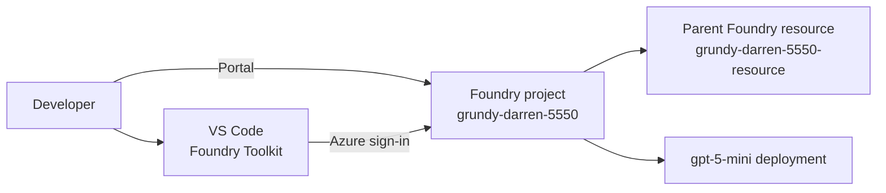

# Prepare for an AI Development Project (AI-103 Lab 1.1)

> A Microsoft Foundry project in my own Azure subscription with a deployed chat model, kept as the shared base for the later AI-103 labs.

## Project status

**Status:** Complete - portal steps verified from the Azure activity log; VS Code Foundry Toolkit step pending

**Context:** Course assignment - Microsoft AI-103, exercise 1.1

This is a portal and developer-environment lab, not a coded application. It repeats the exercise I first completed on the DAX course subscription in July 2026 ([DAX #1](../../ai-engineering-bootcamp/01-foundry-project-setup/)). This time it's in my own subscription, so later labs have a live, validated base.

## Problem

Later AI-103 labs need a working Foundry project, a model deployment and a signed-in local toolchain. The DAX subscription can't be used for live validation (see [AZURE_PLATFORM_BLOCKER.md](../../ai-engineering-bootcamp/AZURE_PLATFORM_BLOCKER.md)), so the base is rebuilt in an environment I control.

## Solution

- Created Foundry project `grundy-darren-5550` and its parent resource `grundy-darren-5550-resource` in East US 2 (6–7 September 2026)
- Deployed `gpt-5-mini` on 7 September 2026 and tested it in the portal playground with a system instruction. The current lab names `gpt-5.2`, but the exercise only needs a deployed chat model. A second model, `gpt-6-astra`, was added on 13 October 2026 for later labs
- Found the key, project endpoint and Azure OpenAI endpoint, and recorded what each one is for
- Installed Foundry Toolkit for VS Code, connected it to the project and used the model playground from VS Code _(pending)_

## Architecture

Resource names are shown. Subscription and tenant IDs, keys and endpoint URLs are left out.

## Technologies

- Microsoft Foundry portal (New Foundry experience): project, model catalog, playground
- Azure OpenAI `gpt-5-mini`: chat model deployment (the current lab uses gpt-5.2)
- Foundry Toolkit for VS Code: project browsing and model playground
- Azure CLI: sign-in and resource verification

## Key capabilities

- Provisioning a Foundry project and parent resource into an existing resource group
- Selecting and deploying a model from the catalog
- Steering model behaviour with system instructions
- Telling resource, project and Azure OpenAI endpoints apart
- Working against Foundry from a local IDE

## Demonstration

**System instruction:** "You are an AI assistant that can provide information and advice about AI software development."

**Prompt:** "Describe three key considerations for working with Large Language Models for AI application development."

**Response:** not kept from the original September run. Azure doesn't log playground chats.

_Pending: a fresh playground excerpt, plus redacted screenshots of the project home page, the portal playground and the Foundry Toolkit playground in VS Code._

## Testing and evidence

| Requirement | Evidence | Assessment |
|---|---|---|
| Foundry project created | Activity log: project and resource created in rg-grundy_darren-4177, East US 2, 6–7 Sep 2026 | Verified |
| Model deployed | Activity log: `gpt-5-mini` deployment succeeded 7 Sep 2026 | Verified |
| Model responding in playground | Not recorded by Azure. Pending a fresh playground screenshot | Not independently verifiable |
| Key and endpoints viewed | Activity log: List Keys events 7–8 Sep and 13 Oct 2026 (values withheld) | Verified |
| VS Code connected to project | Pending screenshot | Pending |

Evidence comes from the Azure activity log (reviewed 2026-11-27), not from screenshots taken at the time. Calling the model from code is covered in Lab 1.3.

Cleanup: the resource group was deliberately kept so later labs can reuse it.

## Known limitations

- Portal-only lab, so there is no source code to run
- The lab was done before Microsoft updated it to gpt-5.2 and the Foundry Toolkit step
- Playground chats aren't logged by Azure, so the original prompt and response weren't kept

## What I learned

_Pending: notes in my own words on the key, the project endpoint and the Azure OpenAI endpoint._

- The lab instructions changed after I ran it: gpt-5.2 replaced the model I used, and a Foundry Toolkit for VS Code step was added. Exercises are living documents, so record the version you ran.

## Next steps

- Lab 1.2: compare models on carrier email triage and freight-rate questions in this same project

## Security and responsible AI

No keys, endpoints, subscription or tenant IDs, or email addresses are published. Screenshots were redacted before commit. Later labs authenticate with Entra ID (`DefaultAzureCredential`) rather than keys.

## Attribution

Exercise steps from Microsoft Learning, [mslearn-ai-studio: Prepare for an AI development project](https://microsoftlearning.github.io/mslearn-ai-studio/Instructions/Exercises/01-Explore-ai-studio.html). No starter code was used.

## Licence

No licence granted; all rights reserved.
