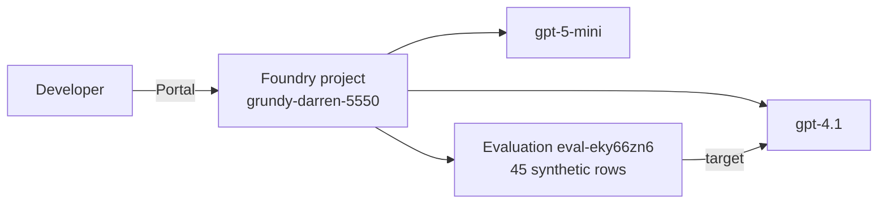

# Explore and Compare Models (AI-103 Lab 1.2)

> Two chat models deployed side by side in Microsoft Foundry, compared in the playground, and evaluated on 45 rows of synthetic data with built-in quality and safety evaluators.

## Project status

**Status:** Complete - deployments and evaluation run verified in the Foundry project; playground comparison not independently verifiable

**Context:** Course assignment - Microsoft AI-103, exercise 1.2

**Lab run:** 7 September 2026, in my own Azure subscription, using the version of the lab current at that time

## Problem

Picking a model for an AI solution should rest on evidence: how models compare on the same prompts, and how a chosen model scores on quality and safety before anyone builds on it.

## Solution

- Used the Foundry project from [Lab 1.1](../1-1-prepare-ai-development/) (`grundy-darren-5550`, East US 2)
- Deployed the two models the lab compared at the time: `gpt-4.1` (6 September 2026) and `gpt-5-mini` (7 September 2026)
- Compared both models side by side in the playground on the lab's reasoning prompt (the fox, chicken and grain river-crossing puzzle)
- Created and ran evaluation `eval-eky66zn6` against `gpt-4.1` with 45 rows of synthetic data, the number the lab asks for

## Architecture

## Technologies

- Microsoft Foundry portal: model catalog, compare-models playground, evaluations
- Azure OpenAI `gpt-4.1` and `gpt-5-mini`
- Foundry built-in evaluators (quality and safety) and synthetic data generation

## Key capabilities

- Selecting and deploying several models from the catalog
- Comparing model responses side by side on the same prompt
- Generating synthetic evaluation data
- Running a model evaluation and reading the results for each evaluator

## Demonstration

Evaluation `eval-eky66zn6`, created 7 September 2026 at 12:37 pm (AEST), took about 19 minutes:

| Metric | Result |
|---|---|
| Overall | 99% (582 of 585 checks passed) |
| Relevance | 96% (43 of 45) |
| ECI | 98% (44 of 45) |
| Groundedness, coherence, fluency | 100% |
| Safety evaluators | 100% |

## Testing and evidence

| Requirement | Evidence | Assessment |
|---|---|---|
| Two models deployed | Project deployments: `gpt-4.1` (6 Sep 2026) and `gpt-5-mini` (7 Sep 2026) | Verified |
| Side-by-side playground comparison | Foundry doesn't keep playground chats | Not independently verifiable |
| Evaluation run on 45 synthetic rows | `eval-eky66zn6`, completed, results above | Verified |

Evidence reviewed in the Foundry portal on 2026-11-27. Screenshots weren't kept from the original run.

## Known limitations

- The lab has changed since I ran it. It now compares `gpt-5.2` with `gpt-5-mini`, where my run used `gpt-4.1`
- The current lab tells you to remove the Safety evaluators. My run kept them, which only adds checks
- The evaluation used synthetic data, not data from my domain

## What I learned

- Near-perfect scores on synthetic data say more about the test data than about the model. The few misses (relevance, ECI) are the rows worth reading
- Side-by-side comparison is quick, but only an evaluation run leaves a record you can come back to

## Next steps

- Supply-chain twist: compare the models on carrier email triage and freight-rate questions using a small hand-written dataset

## Security and responsible AI

Built-in safety evaluators were included and all passed. No keys, endpoints, subscription or tenant IDs are published.

## Attribution

Exercise steps from Microsoft Learning, [mslearn-ai-studio: Explore and compare models](https://microsoftlearning.github.io/mslearn-ai-studio/Instructions/Exercises/02-model-catalog-evaluation.html). No starter code was used.

## Licence

No licence granted; all rights reserved.
