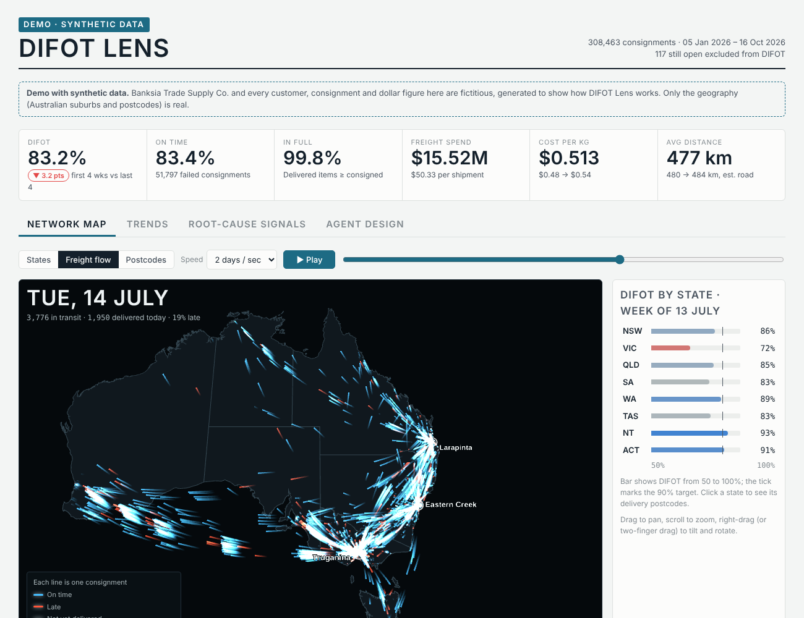
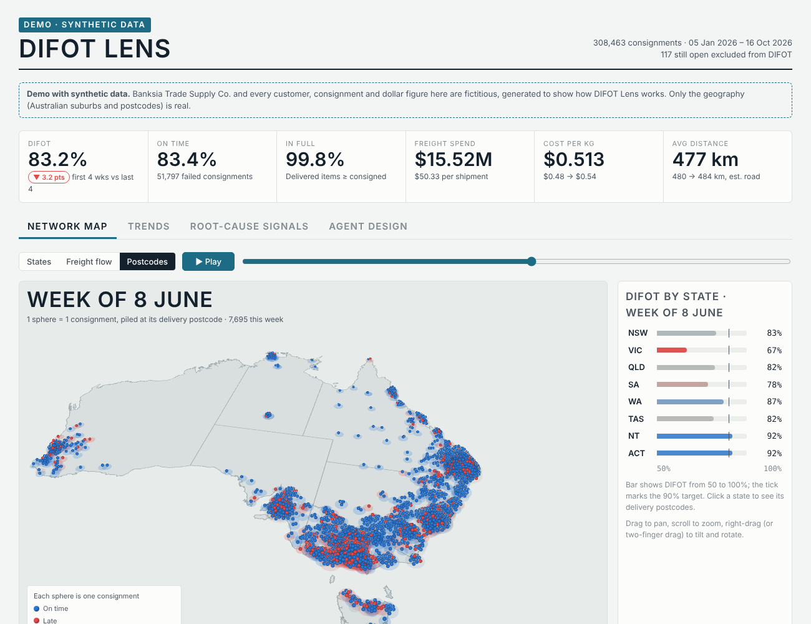
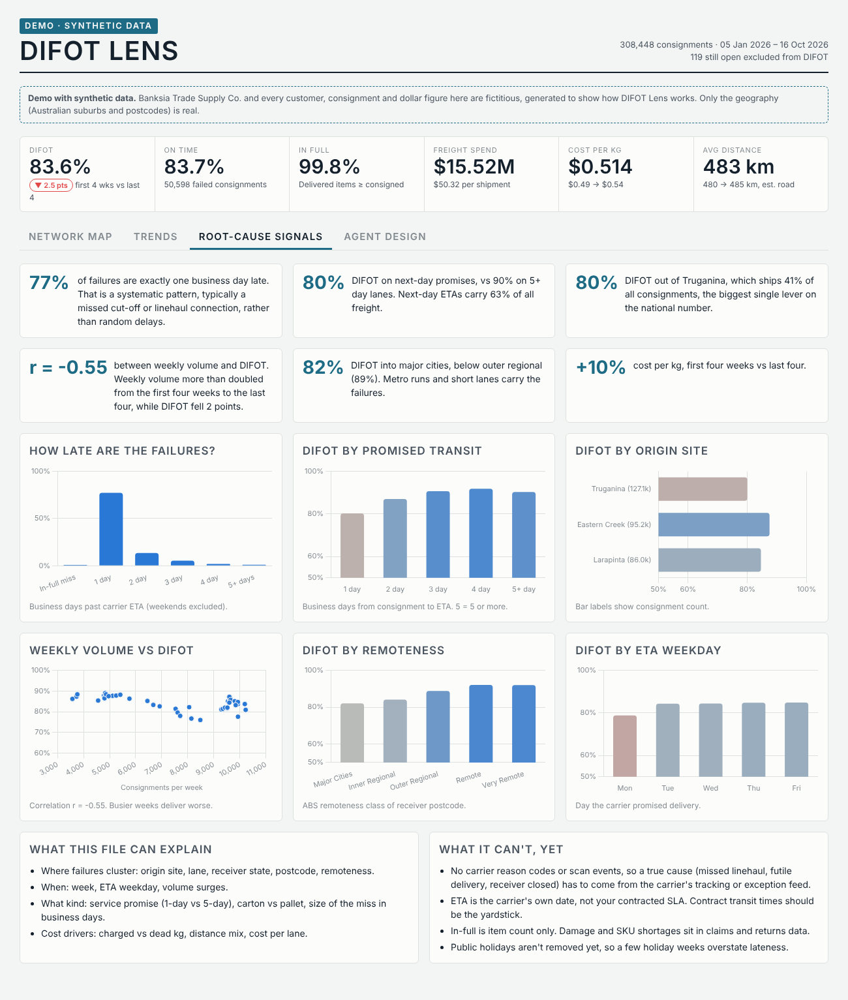

# DIFOT Lens — freight service and cost, made visible

> A deterministic data pipeline and interactive map that turn a carrier's raw consignment export into DIFOT (delivered in full, on time), cost-to-serve and root-cause signals. You can watch every consignment move across Australia, and every number traces back to code rather than a model.



## Project status

**Status:** Working demo — visual and metrics layer complete and reproducible on synthetic data; the agent layer is designed but not built yet.

**Context:** Independent project ([My Lane](https://mylaneai.com.au/)). Phase 1 of a planned DIFOT root-cause multi-agent system. The prototype was built on a real national distribution network's carrier data, then re-created here on synthetic data at double the volume so it can be shared.

## Problem

Transport teams usually get a monthly DIFOT number and a spreadsheet of carrier invoices. Neither says *where* service is breaking, *when* it started, or *why*. The carrier's consignment export already holds most of the answer: dispatch date, promised ETA, delivered date, origin, destination, weight and charge. It's just 300,000 rows that nobody has time to read, so problems surface weeks late and carrier reviews run on anecdote.

## Solution

A pipeline reads the standard carrier `ConnoteList` CSV export, cleans and geocodes it, and computes DIFOT and cost metrics in business days. It writes everything into one self-contained web page with six views:

| View | What you see |
|---|---|
| **States** | 3D state map, weekly time-lapse. Height = consignment volume; colour = DIFOT, cost per shipment or cost per kg. Click a state to drill in. |
| **Freight flow** | One glowing trail per consignment, moving from dispatch to its *actual* delivery date. Blue on time, red late, white not yet delivered. Daily counters for in transit, delivered and % late. |
| **Postcodes** | 1 sphere = 1 consignment, piled at its delivery postcode, week by week. The glow under each pile shows that postcode's DIFOT; the side panel lists the worst postcodes. |
| **Trends** | National and per-state DIFOT; cost per shipment, per kg and per km; average distance. |
| **Root-cause signals** | How late failures are, DIFOT by promised transit time, origin site, remoteness, ETA weekday, and volume vs DIFOT, with auto-written callouts. |
| **Agent design** | The planned multi-agent root-cause architecture. |

**Demo:** open [`demo/index.html`](demo/index.html) in a browser.

## Architecture


The planned agent layer follows the same pattern as the [delivery exception agent](../delivery-exception-agent/): deterministic code owns every number and routing decision, and LLM agents only segment, explain and draft.

## Technologies

- **Python, pandas, NumPy:** cleaning, geocoding, business-day lateness and aggregation.
- **deck.gl 8.9:** WebGL map layers (extruded states, animated trips, billboarded sphere piles).
- **Chart.js 4.4:** trend and root-cause charts.
- **ABS remoteness and postcode reference data:** suburb-level coordinates and the remoteness class for each delivery.

## Key capabilities

- Computes DIFOT, on time and in full in business days, excluding weekends and national holidays.
- Estimates cost per shipment, per kg and per km, including a distance model with manual overrides for postcodes that share one coordinate (for example the Torres Strait islands).
- Animates more than 300k consignments on their real dispatch-to-delivery timeline in the browser.
- Writes root-cause callouts from the data at build time, so the wording follows whatever the numbers show.
- Runs on any carrier export with the same schema; only the config (title, banner, label positions) changes.

## Repository structure

```text
difot-lens/
|-- demo/index.html            # built demo page (synthetic data)
|-- docs/                      # screenshots
|-- ref/get_reference.py       # downloads postcode table + simplifies state boundaries
|-- src/
|   |-- pipeline.py            # load -> prep -> aggregate -> trips -> build
|   `-- template.html          # page template (deck.gl + Chart.js)
|-- synthetic/
|   |-- generate.py            # seeded synthetic connote generator
|   `-- config_demo.json       # page title, banner, label positions
|-- requirements.txt
`-- README.md
```

No `.env` is needed: the project uses no cloud services or credentials.

## Setup

```bash
pip install -r requirements.txt
python ref/get_reference.py                  # postcode table + state boundaries
python synthetic/generate.py --out data      # 318k synthetic consignments (seeded, reproducible)
python src/pipeline.py --csv "data/ConnoteList*.csv" --config synthetic/config_demo.json --out build
```

Open `build/index.html`. The page loads deck.gl, Chart.js and Google Fonts from public CDNs, so it needs an internet connection.

To run on your own carrier export, point `--csv` at the files and copy `config_demo.json`.

## Demonstration

The synthetic year (5 Jan – 23 Oct 2026) has 318k consignments from three east-coast DCs of a fictitious wholesaler, *Banksia Trade Supply Co.* (Larapinta QLD, Eastern Creek NSW, Truganina VIC), going to about 1,450 real delivery suburbs. Five storylines are built into the generator, so the views have something to find:

1. **Truganina capacity crunch** (Apr–Jul): VIC DIFOT falls from the mid-80s into the 60s, then recovers when a second shift starts on 3 Aug.
2. **North Queensland wet season** (Feb–Mar): late deliveries north of Gladstone.
3. **Melbourne → Perth linehaul disruption** (7–27 Sep): a sharp WA dip.
4. **Friday cut-off**: next-day freight dispatched on Friday misses more often, so Monday ETAs are the weakest weekday.
5. **Cost creep**: the fuel levy rises all year and a 4.5% rate review lands on 1 Jul, so cost per kg rises about 12%.

The pipeline isn't told about any of these; it recovers them from the CSVs alone. Headline results: DIFOT 83.2%, $15.5M freight spend, 78% of failures exactly one business day late, and Truganina 80% vs Eastern Creek 87%.

| Postcodes | Root-cause signals |
|---|---|
|  |  |

## Design decisions

- **Deterministic metrics first.** Every number comes from `pipeline.py`. This is the base a later LLM layer must cite, not replace.
- **Business days, not calendar days.** A Friday ETA delivered on Monday is one day late, not three; calendar days would inflate the failure size.
- **One self-contained page.** The data is embedded (about 5 MB), so the demo runs from a file or any static host with no backend.
- **Synthetic data with planted storylines.** It makes the demo shareable and gives labelled ground truth for evaluating the future root-cause agents.
- **Stylised arcs, not road routing.** The flow trails are curved lines between coordinates; routing every consignment wasn't worth the cost for a visual.

## Testing and evidence

- **Reproducibility:** a clean run of the three setup commands rebuilds `demo/index.html` byte for byte with the default seed.
- **Real data run:** the pipeline was first run on a real 159k-consignment carrier export (not published). Its patterns shaped the synthetic storylines. DIFOT has not yet been reconciled against the network's official monthly report.
- **Storyline recovery:** all five planted storylines are visible in the built page's trend and root-cause views.
- **Rendering:** checked in headless Chromium at desktop and phone width, in light and dark themes. Freight-flow animation smoothness was not measured on a GPU in CI.
- **Not yet tested:** no automated unit tests; no evaluation of the agent layer, which isn't built.

## Known limitations

- Root cause is inferred from patterns (where, when, which lane). A true cause needs carrier scan or exception events, which this export doesn't contain.
- ETA is the carrier's promise, not a contracted SLA.
- Distance is a straight line × 1.25, not a routed distance.
- State public holidays aren't modelled, only national ones.
- Very old devices may stutter in Freight flow.

## What I learned

1. A consignment export answers more "why" questions than expected: the size of the miss (78–83% exactly one day late) points to cut-offs and linehaul connections before any reason codes arrive.
2. Network averages mislead. In the real data, cost per km fell while cost per kg rose, purely because the lane mix changed. Lane-level views are essential.
3. Geography data has traps. Some postcodes share one coordinate across dozens of islands, and one territory had no current remoteness class. Both were found by looking at the map, not the tables.
4. Generating synthetic data with deliberate storylines is worth the effort: it makes a demo honest to share and creates ground truth for later evaluation.

## Next steps

- Failure segmentation + critic agent: rank the clusters that explain most failures; reject any claim that doesn't cite a metric.
- RCA agent grounded in carrier scan events and the SLA/rate card, evaluated against the planted storylines.
- "Ask the map": plain-English questions turned into validated view specs.
- Weekly carrier review pack and draft claims, with a human approving them.

## Security and responsible AI

- The published demo uses only synthetic data. The company, customers, consignments and charges are fictitious, and generated customer postcodes exclude the real network's sites.
- The real-data version is kept outside this repository.
- No credentials, endpoints or personal data are used or committed.
- No LLM is involved yet. When agents are added, the metrics engine stays the only source of numbers and a human approves any carrier claim.

## Attribution

- Postcode coordinates and remoteness: [matthewproctor/australianpostcodes](https://github.com/matthewproctor/australianpostcodes). Downloaded at setup, not redistributed.
- State boundaries: [rowanhogan/australian-states](https://github.com/rowanhogan/australian-states). Downloaded and simplified at setup, not redistributed.
- Rendering libraries: [deck.gl](https://deck.gl) (MIT) and [Chart.js](https://www.chartjs.org) (MIT), loaded from CDN.
- Visual inspiration: Aurecon's *Marine Traffic* shipping visualisation, and Craig Taylor's (Ito World) "1 sphere = 1 person" transit work.
- Built with assistance from Claude (Anthropic).

## Licence

No project-specific licence has been granted. Unless stated otherwise, this documentation and the implementation are all rights reserved.
