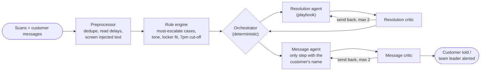

# Where's My Stuff? Last-mile exception agents for Australia

> A multi-agent system that sorts every failed delivery in a day, decides what happens next by the company's own playbook, and tells the customer before they have to ask. Shown on 50,000 synthetic parcels across Melbourne and Sydney, with an animated replay of the whole day.

## Project status

**Status:** Working demo. Full synthetic day run end to end on Claude (Haiku 5.5): 5,295 exceptions, 97.4% fully correct against labelled answers, A$11.50 in API cost.

**Context:** Independent project ([My Lane](https://mylaneai.com.au/)). Australian rebuild of my [delivery-exception-agent](../delivery-exception-agent/) course project, which ran on 10 US test cases.

## Problem

Anyone who has shopped online knows the moment: tracking says "delivery unsuccessful" and nothing else. Roughly one parcel in ten hits an exception: nobody home, no buzzer for the unit, damaged, refused, held up by a storm. Each one needs three decisions, made quickly and by the rules: what actually happened, what the company will do, and what to tell the customer. Done by hand, those decisions lag the event by hours. The customer rings to ask "where's my stuff?", and the high-stakes cases (a VIP's third failed attempt, fresh food sitting in a hot van, a driver who carded a parcel without knocking) get lost in the queue.

## Solution

One synthetic day for **Stoa & Co.**, a fictitious online homewares and fresh-pantry retailer with its own vans in Melbourne and Sydney, run through a six-step pipeline. Plain code handles everything that is a rule. AI handles the judgement and the writing. Every decision is checked by a second AI before it is acted on.

The day was built to look like an Australian delivery day, with storylines for the agents to deal with:

- **39° in Melbourne:** fresh food can't be left at the door, so it's held in the van chiller for the evening run.
- **Extreme fire danger:** a grass fire closes roads into the Dandenong Ranges from 12:15pm.
- **Hail and flash flooding in Sydney:** around Parramatta and Ryde, 1:40 to 3:10pm.
- **Two van breakdowns:** Dandenong South and Botany.
- **Month-end trade refusals:** it's the last business day of February. A distribution centre turns away a delivery that wasn't booked, so the sale slips into March unless someone acts today.
- **"I was home!":** cards left where the van's GPS shows it was 300 m away or stopped for 20 seconds.
- **"It says delivered. It's not here.":** evening claims on safe drops.
- **Apartments:** missing unit numbers and concierges.
- **Fraud and injection:** fraud-pattern addresses, and driver notes that try to give the AI instructions.

Carded parcels go to Australia Post Parcel Lockers (held 2 business days) and Post Offices (10 business days, photo ID). Australia Post is a demo assumption, chosen because everyone recognises it. The locations are illustrative.

**Demo:** open [`demo/index.html`](demo/index.html). Play the 90-second tour, click any dot to follow that parcel through the agents and see the customer's phone, then scroll for the end-of-day scorecard and the "where's my parcel?" chat.

## Architecture



Each node reads and writes the shared state through a typed view (`project_into` / `merge_back` in `src/graph.py`). The customer's name, phone and email exist only in the message agent's view.

## Technologies

- **Claude Haiku 5.5** (Anthropic API): agents and critics, structured output via forced tool use, the playbook as a cached system prompt.
- **LangGraph:** pipeline and revision loops.
- **Python, pandas, NumPy:** synthetic day, preprocessing, rule engine, evaluation.
- **deck.gl 8.9 and Chart.js 4.4:** the demo page.
- **Australian postcode reference** ([matthewproctor/australianpostcodes](https://github.com/matthewproctor/australianpostcodes)): real suburbs and coordinates.

## Key capabilities

- **Rules in code, judgement in the model.** Escalation triggers, the formal/casual tone rule, Parcel Locker eligibility and the "can it still arrive by 7pm?" arithmetic are computed in plain code and passed to the agents. The orchestrator treats escalation triggers as final, so no prompt or model output can talk the system out of one.
- **A written playbook as the only policy source.** The agents read `playbook/exception_playbook.md` (14 sections) and cite the sections they apply.
- **Critics with a hard cap.** Each decision and each message is reviewed. After two rounds of disagreement the case goes to a person, never round again.
- **Privacy by structure.** Only the message agent can see who the customer is; the others work on a redacted profile.
- **Prompt-injection screening.** Driver notes that try to instruct the system are withheld from the agents and escalated.
- **Proactive messages.** SMS or email by the customer's preference, Australian plain English, naming the exact Parcel Locker or Post Office, its hours and how long it's held.
- **"Where's my parcel?" answers** built from the scans as they stood at the moment of the question.
- **Full trace per parcel:** every step's decision, time and cost, which the demo replays.

## Repository structure

```text
last-mile-exception-agent-au/
|-- demo/index.html              # built demo page (synthetic day + recorded agent run)
|-- playbook/exception_playbook.md
|-- ref/get_reference.py         # downloads the postcode table
|-- synthetic/
|   |-- generate.py              # seeded synthetic day (Fri 27 Feb 2026)
|   `-- policy.py                # the playbook as code: writes the answer key
|-- src/
|   |-- world.py                 # read-only tools over the day (scans, customers, lockers)
|   |-- preprocess.py            # dedupe, delays, injection screen
|   |-- rules.py                 # deterministic rule engine
|   |-- agents.py                # output schemas and agent instructions
|   |-- graph.py                 # LangGraph pipeline with typed views
|   |-- llm.py                   # Claude client, caching, cost accounting
|   |-- run.py                   # batch runner (resumable)
|   |-- evaluate.py              # scores a run against the answer key
|   |-- build_demo.py            # builds demo/index.html from a run
|   `-- demo_template.html
|-- .env.example
|-- requirements.txt
`-- README.md
```

## Setup

Clone outside OneDrive (git and OneDrive sync clash), then from this folder:

```powershell
python -m venv .venv
.\.venv\Scripts\Activate.ps1
pip install -r requirements.txt
python ref/get_reference.py
python synthetic/generate.py --out data          # ~2 minutes; seeded, so the same day every time
```

Put `ANTHROPIC_API_KEY=...` in a `.env` file. It can live outside the repo; pass its path with `--env`.

```powershell
python src/run.py --dry-run --sample 5 --out runs/dry                         # plumbing check, no API calls
python src/run.py --env path\to\.env --sample 40 --out runs/test40            # every exception type, ~US$0.06
python src/run.py --env path\to\.env --all --wismo -1 --workers 6 --out runs/full   # whole day, ~US$8, resumable
python src/evaluate.py --run runs/full
python src/build_demo.py --run runs/full --out demo/index.html --aud-rate 1.43
```

The runner stops cleanly if the API key is wrong or the account runs out of credit. Re-running the same command carries on where it stopped.

## Testing and evidence

`synthetic/policy.py` turns the playbook into code and labels every exception with the expected resolution, Parcel Locker or Post Office, escalation and tone. `src/evaluate.py` scores a run against those labels.

Two full-day runs on Claude Haiku 5.5. Run 2 has the fixes from what run 1 found.

| Metric | Run 1 | Run 2 |
|---|---|---|
| Exceptions | 5,296 | 5,295 |
| Fully correct (resolution, collection point, escalation and tone all right) | 88.0% | **97.4%** |
| Resolution | 96.1% | 99.6% |
| Parcel Locker / Post Office choice | 90.4% | 99.7% |
| Escalation accuracy | 97.0% | 97.8% |
| Cases needing a person that got one (recall) | 98.4% | **100%** |
| Tone | 93.6% | 98.3% |
| Channel (SMS / email) | 100% | 100% |
| Injected driver notes caught | 6 / 6 | 6 / 6 |
| Messages leaking driver notes, GPS or fraud detail | 1 | **0** |
| Typical time per exception | ~6 s | ~6 s |
| API cost | US$8.13 | US$8.02 (about A$11.50) |

**What run 1 found, and what changed:**
- **The synthetic data contradicted itself.** Drivers wrote "sig req'd" on parcels whose record said no signature was needed. The agents reasonably sent those to the Post Office, which caused most of the locker misses and most of the agent–critic disputes. Notes now match the record.
- **Tone was missed for Premium customers in 258 cases.** Tone is now set by rule in code, since it is a lookup on tier, account type and escalation.
- **Locker size and capacity rules were sometimes misapplied, and the tool only showed four lockers.** The tool now lists every locker within 3 km, with a plain-code "fits this parcel" check, the way a real locker network's API would.
- **Review escalations were left to the agent and missed 10 times.** Both trigger lists are now enforced.
- **One message mentioned the van's GPS distance.** The message instructions now forbid distances, and the checker looks for them.

**What the answer key does and doesn't test.** The labels come from the same written policy the agents read, so the scores measure how faithfully the agents follow the playbook, not whether the playbook is right. The escalation triggers and tone are computed in code, so their labels mainly test the plumbing. The model is tested on choosing the resolution, the collection point and the wording of each message.

## Known limitations

- **The critic is over-cautious.** In run 2, 115 correct decisions were escalated only because the critic kept objecting until the two-round cap ended the loop. That is the safe direction to fail, but it adds team-leader work: escalation precision is 84%. Next step: give the critic the same code-computed facts in a checklist, or try a larger critic model on the disputed cases only.
- **Fraud-pattern addresses.** In 9 cases the agent chose "return to sender" where the answer key says "reschedule". The playbook says not to redeliver until a team leader clears the address, without naming the resolution to log, so this is a gap in the playbook. All 9 were escalated.
- **One synthetic day, one retailer, two cities.** Not production traffic. Australia Post locations are illustrative.
- **No live integrations.** Scans come from a CSV and messages are recorded, not sent. A real deployment would start in shadow mode alongside the existing exception desk.
- **The demo replays a recorded run.** Nothing calls the API when the page is viewed.

## Security and responsible AI

- The API key loads from a `.env` file that is git-ignored; only `.env.example` is committed.
- Customer identity is structurally limited to the message agent (typed state views), not just told to stay out of prompts.
- Driver notes and customer messages are treated as data. Injection attempts are withheld from the agents and escalated.
- The decisions that must never be wrong (third attempt, cards without a genuine attempt, damaged fresh food, fraud patterns, repeat "not received" claims, month-end trade refusals) are enforced in code.
- All data is synthetic: fictional retailer, customers, names, addresses (real suburbs, invented streets) and parcels. Phone numbers use the ACMA fiction range; emails use example.com.

## What I learned

1. **Bad data looks like bad AI.** The biggest single cause of misses in run 1 was a contradiction I had put in the synthetic data. The agents handled it sensibly; the score just couldn't tell. Read the traces before blaming the model.
2. **If it's a lookup, do it in code.** Tone, locker eligibility and the 7pm arithmetic were each a source of model errors and each a few lines of Python. Moving them out of the prompt left the model the work only it can do.
3. **Critics need permission to agree.** Making the critic name a concrete error before sending work back took the first test from 70% to 95%. At full scale it is still the main source of unnecessary escalations.
4. **Score the whole day, not ten cases.** Twenty and forty-case tests came back at 95–100%. The full 5,000-case day is what exposed the real patterns.
5. **Design for the stop.** A full day of API calls will hit sleep, rate limits and an empty credit balance. A runner that saves every parcel as it goes and resumes cleanly mattered as much as the prompts.

## Attribution

The architecture (preprocessor, deterministic router, resolution and communication agents with critics, rule engine, typed views) is adapted from my final project for the UT Austin Post-Graduate Program in AI Agents for Business Applications (2026, delivered via Great Learning). The Australian scenario, playbook, data, code and demo are new.

## Licence

No project-specific licence has been granted. Unless stated otherwise, this documentation and the original implementation are all rights reserved.
