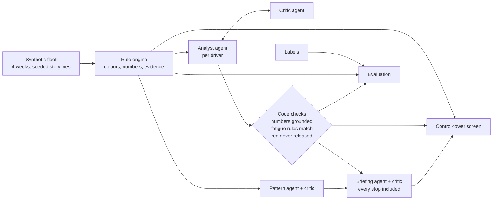

# Before Start Safety/CoR Check

> A control-tower screen for the 05:30 before-start check: deterministic Chain of Responsibility rules set a traffic light for every driver, and Claude agents explain each stop, name who in the chain owns the fix and write the dispatch briefing.

## Project status

**Status:** Working demo. A rule engine on a synthetic 4-week fleet meets all 25 labelled scenarios with no unexpected findings. Claude Haiku agents ran 3 times on the same data: every red item got a stop decision and the accountable party was right in all 3 runs. Not yet tested on real operator data.

**Context:** Independent project ([My Lane](https://mylaneai.com.au/)). Rebuild of the UT Austin capstone [`transport-cor-multi-agent`](../transport-cor-multi-agent/), which is left unchanged.

## Problem

Before trucks leave the yard, a transport controller has minutes to answer one question: **which planned trips should not leave as planned?** The evidence is spread across systems: the electronic work diary, telematics, the dispatch plan, weighbridge tickets, restraint and training records, and fleet maintenance.

Under the Heavy Vehicle National Law (HVNL), the Chain of Responsibility makes every party who influences a trip responsible for its safety: schedulers, loaders, consignors, operators and executives as well as drivers. The real cause of a breach often sits upstream of the driver: a roster that leaves no rest, a customer's dock window, a consignor's under-declared weights. A daily list of exceptions hides those patterns.

## Solution

A one-screen check for 36 drivers and three days of planned trips at a fictional Laverton North operator.

- **Stop / Watch / Go, one row per driver**, each with six check lights: fatigue, mass, load restraint, speed, maintenance and work diary records.
  - **Red (stop):** a breach has happened or the plan would cause one: over the fatigue limits, over mass, failed restraint gear, an open major defect, a trip with no matching work diary entry.
  - **Amber (watch):** close or uncertain: under 10 km/h over entering a lower zone, service due within 2 days, competency expiring, a weighbridge ticket still to come.
  - **Green (go):** every check ran with complete evidence. Missing evidence is never green.
- **A decision and owner for each stop**, for example "Hold MV1102-1236 until the steel load is re-weighed under 44.0 t. Owner: consignor, loader".
- **Checkpoint replay:** an animated truck drives through the yard gates (sign-on, vehicle pre-start check, load and restraint check, weighbridge) or out along its lane. It stops where the problem is and shows the numbers. Fatigue stops include a work and rest timeline with the counting period that breaches.
- **Easy to miss:** four-week patterns, such as one consignor declaring every load about 7.5% light, or five drivers speeding at the same spot 12–17 minutes before the same customer's delivery slot.
- **A 05:30 briefing** and a **scorecard** of how the agents scored.

## Architecture



The rule engine is the only source of colours and numbers. Agents explain and assign; they never change a colour. Code checks around the model catch the errors a reviewing model can miss.

## Technologies

- **Python, numpy:** a seeded data generator and minute-resolution fatigue counting.
- **Claude Haiku 5.5** (`claude-haiku-5-5`) through the Anthropic SDK, using forced tool calls for structured output: analyst, critic, pattern and briefing agents.
- **Static HTML/SVG/JS:** a single self-contained page with no server or API key needed to view it.
- **pytest:** fatigue boundary cases and the code-level agent checks.

## Key capabilities

- **NHVR standard hours, solo and two-up, every window:** 5.5 h, 8 h, 11 h, 24 h, 7 days and 14 days, night rest breaks, and the two-up 52 h rest.
  - Time is counted to the minute as an EWD does; rest under 15 minutes does not count.
  - 24 h and longer periods are counted from the end of the relevant major rest.
  - The engine also works out the earliest compliant start.
- **Mass:** General Mass Limits for the combination and steer axle, declared weight against weighbridge, and missing ticket or JSEA.
- **Load restraint:** Load Restraint Guide 2025 tie-down table (lashings per row), competency expiry, and failed gear still in service.
- **Speed, maintenance and records:**
  - repeat speeding with no follow-up, map limits marked low-confidence, service point against trip distance, open defects, workshop clashes;
  - vehicle movement with no matching work diary entry, never inferring the driver from the vehicle;
  - stale telematics feeds.
- **Agents:** decision, root cause, accountable party, action and explanation per issue. A critic must flag a concrete error to send work back (at most 2 revisions). There is also a pattern agent and a briefing writer, each with its own critic.
- **Code checks on the agents:**
  - every number must appear in the evidence;
  - quoted rest hours and work limits must match the driver's hours option;
  - a weekday must match its date;
  - a red item can never be released, and an invalid decision is forced to hold;
  - every stopped driver must appear in the briefing.

## Repository structure

```text
transport-cor-au/
|-- synthetic/          # generate.py (seeded fleet), storylines.py (20 labelled problems + 5 decoys)
|-- src/
|   |-- engine/         # fatigue.py (NHVR counting), rules.py (all six areas, traffic light)
|   |-- run_engine.py, evaluate_engine.py
|   |-- agents.py       # analyst, critic, pattern, briefing + code checks
|   |-- evaluate_agents.py, run_series.py
|   `-- build_tower.py  # builds the self-contained screen
|-- tests/              # fatigue boundaries, agent code checks
|-- demo/               # tower.html (open in a browser), tower_template.html
|-- build/              # committed evidence: findings, agent output, evaluation, 3-run series
|-- ref/sources.md      # NHVR extracts with retrieval date
|-- docs/DESIGN.md
|-- .env.example
`-- requirements.txt
```

## Setup

```powershell
python -m venv .venv
.\.venv\Scripts\Activate.ps1
pip install -r requirements.txt
Copy-Item .env.example .env        # add ANTHROPIC_API_KEY (agents only)

python synthetic/generate.py --out data     # seeded, deterministic
python src/run_engine.py                     # build/findings.json
python src/evaluate_engine.py                # engine against labels
python -m pytest -q tests
python src/agents.py                         # build/agents.json (needs the API key)
python src/evaluate_agents.py                # build/eval.json
python src/run_series.py --runs 3            # spread across runs
python src/build_tower.py                    # demo/tower.html
```

No API key is needed for the rule engine, the tests or the screen.

## Demonstration

Open `demo/tower.html` in a browser. The snapshot is Monday 2 November 2026, 05:30 AEDT, with 159 planned trips: 13 drivers to stop, 13 to watch and 10 clear to go. Examples:

- **Fatigue:** a driver finished a Sunday call-out at 23:30 and is rostered for 06:00. The 24 h period that began at 07:00 Sunday already holds 12 h of work, so the earliest compliant start is **07:00**. The capstone demo had cleared 06:30, which still breaches the 12 h work limit.
- **Two-up:** a Sydney return was brought forward from 18:45 to 08:45 at a customer's request, leaving the pair without their 5 h rest. The agents stop the trip and name the scheduler (and in 2 of 3 runs the consignor). They class the cause as roster planning rather than the customer window that the label expects.
- **Mass:** a steel load is 45.2 t against a 44.0 t limit. The same consignor declared light on every load over four weeks.
- **Speed:** five drivers are 5–9 km/h over entering the Corio 60 zone from an 80. Every event was on a trip to the same customer, 12–17 minutes before its delivery slot. The agents recommend fixing the slot before talking to drivers one by one.

## Design decisions

- **Rules set the colour; models explain it.** Legal limits and thresholds stay in code where they can be tested. The model's job is judgement: cause, owner, action and wording.
- **Missing evidence is not a pass.** No ticket, no diary entry or a stale feed gives a stop or watch, never a green.
- **Code checks around the critic.** The critic missed a truncated briefing and a two-up driver described with the solo 7 h rest. Both are now caught by deterministic checks.
- **Labels may use only facts in the data.** In the first runs, two labels relied on facts the agents could not see: why a trip was brought forward, and a customer's delivery slot. These were added as dispatch records, not tuned into prompts.
- **Upstream ownership.** Prompts and patterns push the analysis toward the party who can remove the cause, which is the point of the Chain of Responsibility.

## Testing and evidence

**Rule engine:** all 25 labelled scenarios met (20 storylines, 5 decoys that must stay green), with no findings on unlabelled trips. Generation is deterministic (same seed, identical files). There are 23 unit tests, including the 06:00 / 06:30 / 07:00 fatigue boundary, 7-day and 14-day limits, two-up 52 h, and the agent code checks.

**Agents** (`claude-haiku-5-5`), 3 runs on the same data, 24 scored scenarios each (`build/series.json`):

| Measure | Mean | Range |
|---|---|---|
| Red items given a stop decision | 100% | 100–100% |
| Accountable party correct | 100% | 100–100% |
| Stop vs go matches | 94.4% | 91.7–95.8% |
| Root cause matches | 79.2% | 75.0–83.3% |
| Exact decision matches | 76.4% | 75.0–79.2% |
| Numbers not found in the evidence (final output) | 0 | 0–0 |
| Fatigue rules quoted wrongly (final output) | 0 | 0–0 |

Each run takes about 65 API calls and 2 minutes.

- **Where the misses are:** neighbouring answers, such as hold or reschedule for a truck that needs swapping, and roster or customer window for the Corio pattern. The reasoning in those cases is sound.
- **What the code checks caught:**
  - the solo 7 h rest quoted for a two-up driver, in 2 of 3 runs, fixed on revision;
  - in an earlier run, an invalid decision value on a red item, forced to hold;
  - a briefing cut off mid-list that the critic had passed.
- **Invented category:** one run returned a root cause that is not in the allowed list ("DELIVERY_WINDOW"). It is scored as a miss, and the guard now relabels unknown values as unclassified.

**Not verified:** behaviour on real EWD or telematics feeds, BFM/AFM/ACH or exemption hours, and review by a CoR or fatigue specialist.

## Known limitations

- **Fatigue scope:** standard hours only. BFM, AFM, ACH, exemptions and fitness for duty are not assessed.
- **Operator procedures, not HVNL:** service intervals, training validity, the 14-day competency watch, speed tolerances and follow-up rules belong to the fictional operator.
- **Mass:** a combination and steer-axle check against General Mass Limits only. Higher Mass Limits, permits and dimension checks are not modelled.
- **Map:** the replay map is a schematic of the main lanes, not a real map.
- **Small evaluation:** 24 scored scenarios. Results will vary on other data.

## What I learned

- **Counting periods matter more than limits.** The obvious rest check (7 h since the last shift) passed a start that still breached the 12 h work limit in its 24 h period. NHVR's own counting-time example shows the same trap.
- **A reviewing model is not a safety control.** The critic passed a truncated briefing and listed things it agreed with as errors. Deterministic checks for completeness, grounding and rule match did the real work, and the critic then improved wording and judgement.
- **Labels should only use facts in the data.** If the agent cannot see a fact, a miss measures the dataset, not the agent.

## Next steps

- **Pre-start vehicle checklist data:** a failed horn, lights or indicators would be a hard stop set by a rule, with retrieval supplying the wording and control.
- **Real feed adapters:** EWD, telematics and fleet feeds with correction and staleness handling.
- **A reviewed rule catalogue and specialist review:** extend to BFM, ACH and exemptions.

## Security and responsible AI

- **Data:** synthetic only. All people, companies and records are fictional, and driver identity is never inferred from vehicle movement.
- **API key:** the Anthropic key is read from `.env`, which is git-ignored.
- **Human decision:** this is decision support. It does not certify compliance or release a vehicle, and a controller makes every release decision.
- **Agent limits:** agents cannot change a colour or release a red item.

## Attribution

- NHVR, [Work and rest hours](https://www.nhvr.gov.au/safety-accreditation-compliance/fatigue-management/work-and-rest-hours), [Counting time](https://www.nhvr.gov.au/safety-accreditation-compliance/fatigue-management/counting-time) and [General Mass Limits](https://www.nhvr.gov.au/road-access/mass-and-dimension/mass-limits/general-mass-limits), retrieved 2 November 2026. These pages include the HVNL changes that began on 1 August 2026.
- NHVR [Load Restraint Guide 2025](https://www.nhvr.gov.au/road-access/loading/load-restraint-guide), case study 1, tie-down table (pp. 205–207). Values are transcribed in `ref/sources.md`. Licence terms for the 2025 edition were not confirmed, so the tables are not reproduced beyond what the checks need.
- Original concept: the author's UT Austin capstone [`transport-cor-multi-agent`](../transport-cor-multi-agent/).
- Built with assistance from Claude.

## Licence

No licence has been granted. All rights reserved.
